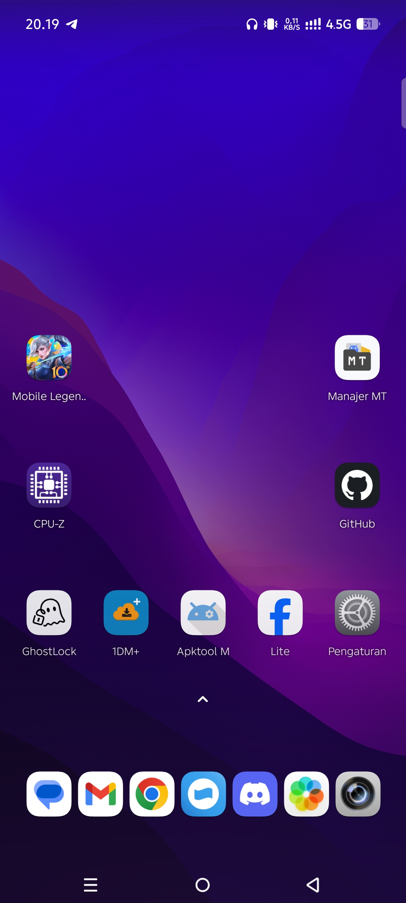
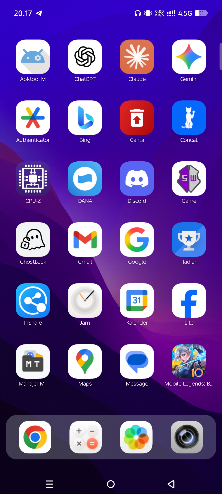
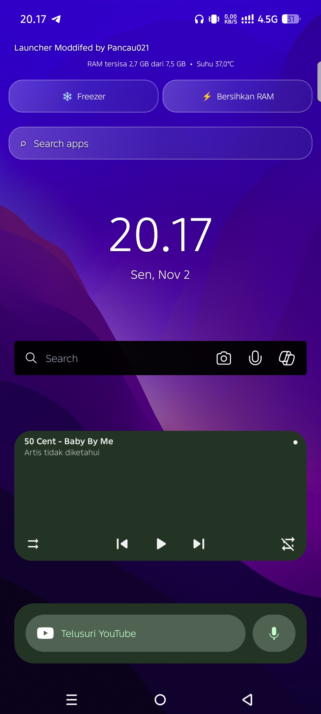
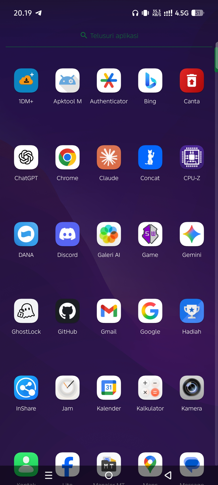

Trebuchet Launcher Mod

A customized Trebuchet Launcher by Pancau021.

Featuring an enhanced SpringBoard experience, improved UI, additional customization, and useful system utilities.

Preview

## Screenshots

### Classic Mode

### SpringBoard Mode

### Today View / Widgets Page

### Classic App Menu

Features

- Classic Mode & SpringBoard Mode
- Customizable Dock Position
- App Freezer
- RAM Cleaner
- Total RAM Information
- Phone Temperature Information
- Double Tap to Sleep
- Hide Applications
- Custom Animations
- Swipe Down to Open Status Bar
- ".zth" Icon Theme Support
- Improved Icon Movement
- Improved Dock
- Various UI Improvements

Download

Get the latest version:

"Download Trebuchet Mod v1.0.0" (../../releases/latest)

Compatibility

Universal APK. Compatibility may vary depending on Android version and device configuration.

Credits

- Original Launcher: Trebuchet
- SpringBoard Base: Aherdi S
- Modifications & Development: Pancau021

Developer

Pancau021 Android Development

Modifying Android, One Feature at a Time.
